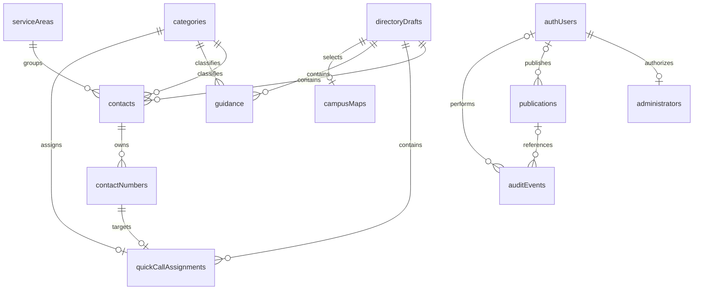

# Relational directory database

Implemented locally by `202610290001_relational_directory.sql` and `202610290002_scoped_relational_save.sql` on 29 October 2026. Hosted application of this migration and frontend deployment remain separate release steps. Public visitors continue to receive the existing v1 JSON publication format.

## Tables and relationships

| Table                    | Purpose and relationships                                                                                                                                              |
| ------------------------ | ---------------------------------------------------------------------------------------------------------------------------------------------------------------------- |
| `categories`             | Six fixed bilingual categories. One category has many contacts/guidance topics and at most one Home quick-call assignment.                                             |
| `service_areas`          | Three fixed bilingual areas. One area has many contacts.                                                                                                               |
| `directory_drafts`       | One private working-directory revision and scalar compatibility metadata. Its boolean primary key remains constrained to true.                                         |
| `contacts`               | Belongs to the working draft, one category and one service area. Holds agency/branch, bilingual description, aliases, hours, source, verification and approval status. |
| `contact_numbers`        | Each line belongs to one contact. Holds bilingual labels, display/dial values, extension and voice/text channel.                                                       |
| `quick_call_assignments` | One row per assigned category, referencing one exact phone line. Contact identity is derived from the line; it is not stored a second time.                            |
| `guidance`               | Belongs to a category and draft. Bilingual title, ordered bilingual JSON steps, source and review fields.                                                              |
| `campus_maps`            | At most one selected map record per draft. Metadata points to the existing private Storage asset; instructions remain ordered bilingual JSON.                          |
| `administrators`         | One active/inactive membership per invited Auth identity. An Auth account alone does not grant administration access.                                                  |
| `publications`           | Immutable snapshot content, current-version flag, nullable source revision and publisher identity. Older provenance remains null rather than inferred.                 |
| `audit_events`           | Actor, action, draft revision and optional publication reference. Identity removal clears references while retaining history.                                          |

`auth.users` is Supabase-managed. `administrators.user_id`, `publications.published_by` and `audit_events.actor_id` reference its primary key. Administrator membership cascades on account deletion; publisher/actor references become null. Audit publication references do not cascade-delete history.

The diagram describes database relationships. Save-time document validation still requires at least one line per contact, matching the existing editor; the FK alone permits an empty collection. Publication additionally requires approved active content and reviewed translations.

## Reading and writing

`get_directory_draft()` is an administrator-only, stable function returning `{payload, revision}` in one consistent database snapshot. `payload` is assembled from the working tables; it is no longer a stored competing full document. Dashboard, preview and pre-publication validation use this function.

`save_directory(document, expected_revision)` retains the application's existing save contract. It locks the singleton draft, checks the expected revision, validates the document and replaces related working rows in one transaction. It clears assignments before replacing phone lines, then reinstates the submitted valid references. Any failure rolls back all rows, the revision and the audit event. A stale or null revision is rejected. Saves still serialize across the whole directory; this redesign does not introduce per-contact concurrent editing.

Replacement deletes explicitly scope the working directory and retain Supabase API safe-update protections. New primary/foreign/unique keys reject duplicate global phone-line IDs, missing contacts/lines, duplicate category assignments and invalid lookup IDs. The application supplies clear messages before attempting a save. A selected line must belong to the submitted contact; its owner is never silently substituted. Clear/reassign shortcuts before deleting their targets. Changing a contact's active state/category or a line's channel may be saved for review, but incompatible shortcuts block publication.

`publish_directory(expected_revision)` locks the same draft and validates the assembled document before filtering inactive contacts. It creates one complete snapshot, records the publisher/revision, switches the current version and records its audit reference atomically. A partial unique index permits at most one current version. Public readers remain isolated from private working rows and never receive partially saved content.

`restore_directory(source_id, expected_revision)` imports a historical snapshot through the same save function and publishes a new version within one transaction. Original verification dates and historical snapshot content remain unchanged. A failed restore leaves both the working directory and current publication unchanged.

## Compatibility and permissions

- Contact, number, guidance and quick-call order is preserved with explicit position columns. UUIDs, bilingual text, aliases, extensions, approval flags and original verification dates are preserved.
- The stored legacy priority value and inert test-contact metadata remain readable so existing v1 documents round-trip. The presence/absence of the optional `quickCalls` field is retained. Neither legacy field has a new user interface.
- Guidance/map review dates remain required, as in the existing editor and validation contract. Contact verification may remain unset in a private draft.
- Fixed category/area IDs and their seed labels match application definitions. Arbitrary category creation and a general translation-management interface are outside this change.
- All new tables have RLS. Anonymous roles have no private-table access; authenticated non-administrators see no working records. Administrators can read but cannot directly modify working tables. They save/publish through authorized functions.
- Internal importer/assembler helpers have no execute grant for public, anonymous or authenticated roles. Functions use an empty search path. No browser service-role credential is introduced.
- A trigger rejects deletion or alteration of published snapshot content and provenance. The current flag may change, and account deletion may clear publisher identity. This is not a substitute for independent backups or protection against a database superuser.

## Migration and release

1. Test on a local/staging copy. `pnpm test:migration` creates and deletes a disposable local database, checking populated/legacy conversion and full rollback for invalid references/duplicate IDs.
2. A trusted operator backs up the intended database, Auth identities and Storage image bytes. Test restoration separately. Do not use publication history as the only backup.
3. Review pending migrations for that exact project. The migration locks the draft, backfills rows and compares the reconstructed document against the original before dropping the old payload. It does not rewrite existing publication snapshots. An unrepresentable draft aborts the transaction; investigate it rather than resetting the database or silently changing IDs.
4. Coordinate migration and application release in an administrator maintenance window. Apply pending versioned migrations, including the earlier quick-call migration, then deploy this application's matching administrator reader. Old administrator code expects a removed `payload` column and must not remain in use. Existing public publication readers remain compatible.
5. Verify administrator sign-in, save, preview, publish, public refresh, map access, history/restore and anonymous/private access on the intended host. Keep the offline-retirement asset available for older browsers.
6. If rollout fails, use a reviewed forward fix or restore the pre-migration backup in a controlled maintenance window. Reverting frontend code alone does not restore the removed payload column.

Local command: `pnpm exec supabase migration up --local`. Hosted migration is not run automatically by the application. The first-time bootstrap generator removes per-file transaction wrappers and wraps the complete fresh installation in one transaction; it continues to refuse existing QROTECT objects.

Checks: `pnpm test:migration`, `pnpm test:db`, `pnpm test`, `pnpm check`, and `pnpm test:browser`. The integration/browser runners use local test data; telephone links are intercepted.
